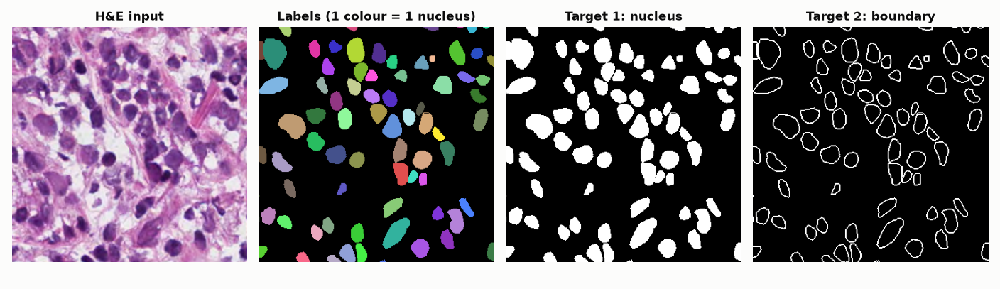
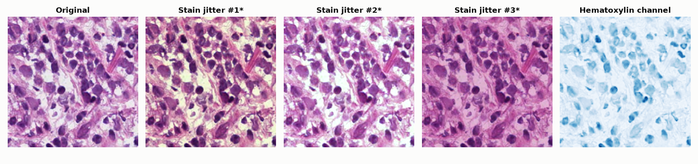
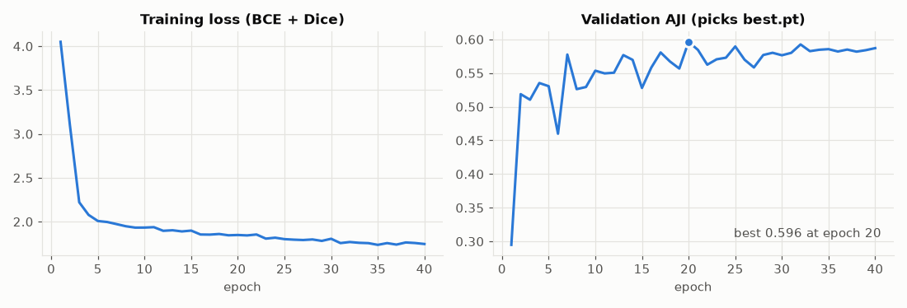
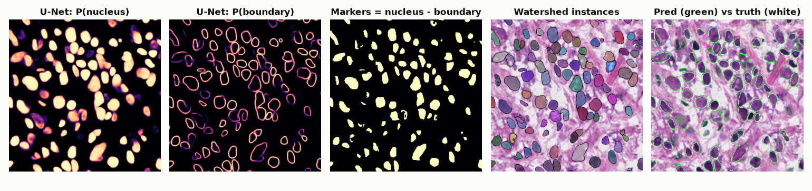
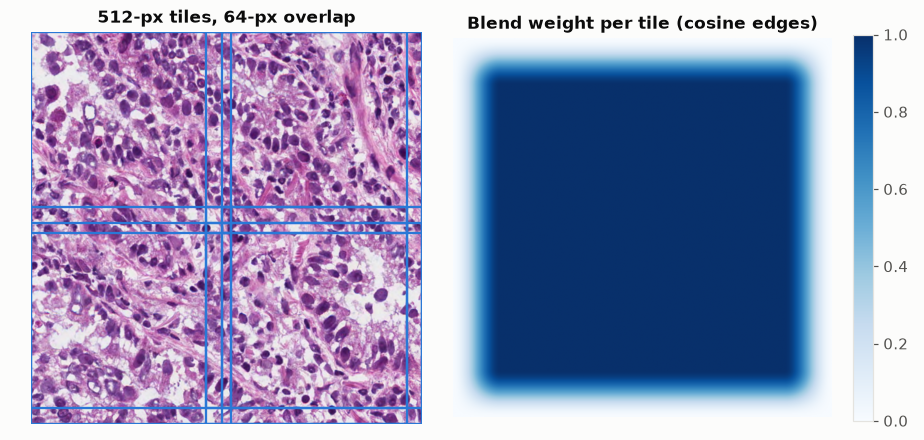
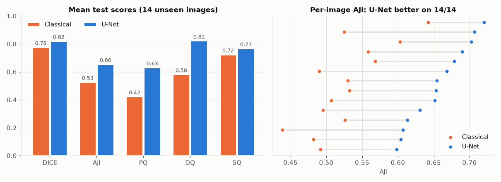
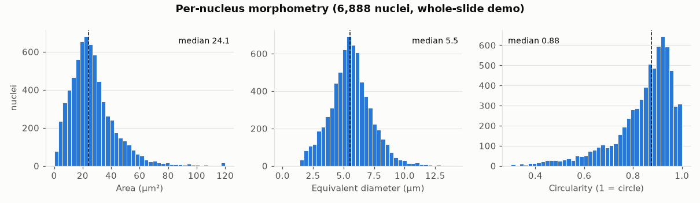
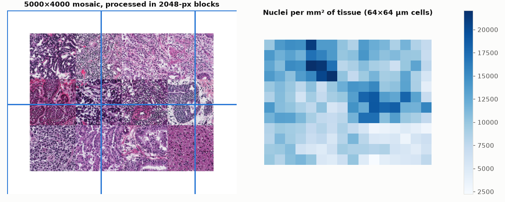

# NucleiScope

**Nucleus segmentation and morphometry for H&E histopathology, from 1000-px tiles up to gigapixel whole-slide images.**

NucleiScope finds every cell nucleus in an H&E-stained tissue image, separates nuclei that touch each other, and measures each one in microns: area, diameter, shape and stain density. It then summarises the tissue, for example nuclei per mm² and how much nucleus size varies. These measurements are the building blocks of digital-pathology tasks such as tumour grading, cellularity scoring and quantifying the effect of a drug in a pre-clinical study.

```
H&E image ──► stain aug / Macenko norm ──► U-Net (PyTorch) ──► nucleus + boundary maps
                                                                         │
             nuclei.csv, summary.json, density heatmap  ◄── morphometry ◄── marker watershed
```

**Headline result (MoNuSeg test set, 14 unseen patients):** AJI **0.656** and PQ **0.631**, against 0.528 and 0.423 for a classical image-processing pipeline. The U-Net beats the classical pipeline on **all 14** test images.

## What's inside

| Component | File | What it does |
|---|---|---|
| Stain handling | `nucleiscope/stain.py` | Macenko stain normalization; random stain-concentration jitter for training |
| Model | `nucleiscope/model.py` | U-Net with **two outputs: nucleus and nucleus boundary**; BCE + Dice loss |
| Instance separation | `nucleiscope/post.py` | Watershed seeded from nucleus cores (*nucleus minus boundary*), which splits touching nuclei |
| Tiled inference | `nucleiscope/infer.py` | Sliding window with cosine-weighted blending, so tile edges leave no seams; optional flip-based test-time augmentation; automatic CUDA / Apple MPS / CPU selection |
| Whole-slide engine | `nucleiscope/wsi.py` | Processes the slide in blocks with a halo border and keeps each nucleus once (by its centroid); skips blocks with no tissue; memory use doesn't grow with slide size |
| Morphometry | `nucleiscope/morph.py` | Per-nucleus area, perimeter, diameter, axes, eccentricity, solidity, circularity and hematoxylin intensity, all in µm |
| Metrics | `nucleiscope/metrics.py` | Dice, IoU, **AJI** (the MoNuSeg challenge metric), **PQ** (panoptic quality) |
| Classical baseline | `nucleiscope/baseline.py` | Colour deconvolution + Otsu threshold + distance-transform watershed, with no learning |
| Tests | `tests/test_core.py` | Metrics, splitting of touching nuclei, measurement units, seamless tiling, and the whole-slide rule that counts each nucleus once |

## Results: MoNuSeg test set (14 images, unseen patients)

| Method | Dice | IoU | **AJI** | **PQ** | DQ (detection F1) | SQ (segmentation IoU) |
|---|---|---|---|---|---|---|
| Classical: colour deconvolution + Otsu + watershed | 0.777 | 0.637 | 0.528 | 0.423 | 0.583 | 0.724 |
| **U-Net + boundary watershed** (7.8M params) | **0.821** | **0.697** | **0.656** | **0.631** | **0.822** | **0.767** |

- **Gains over classical:** the U-Net improves AJI by **+0.13** and PQ by **+0.21**, and it beats the classical pipeline on all 14 test images. Per-image AJI ranges from 0.598 to 0.720.
- **Where the gain comes from:** mostly detection (DQ 0.58 → 0.82). The classical method splits nuclei into fragments, predicting 11,190 against 6,697 true. The U-Net predicts 8,179.
- **Per-image scores:** in `results/*/per_image.csv`.

**Whole-slide check:** `scripts/wsi_demo.py` was run on a 5000 × 4000 mosaic of 12 test tiles with a white glass border.
- Processed in 6 blocks; found 6,888 nuclei (ground truth: 5,689).
- Mean nucleus area 26.9 µm²; mean diameter 5.6 µm.
- Speed: **1.68 MP/s on an Apple M4 GPU**, 11.9 s in total.

**Training setup:**
- 40 epochs × 200 steps of 8 random 256-px crops.
- U-Net of width 32 (7.8M parameters).
- Trained on an **Apple M4 GPU (MPS)** in about 65 minutes.

**Model selection:**
- The checkpoint was chosen by AJI on 5 training images held out for validation: best 0.596 at epoch 20.
- The post-processing thresholds (`--fg-t 0.4 --mk-t 0.7`) were tuned on those same validation images.
- **The test set was never used for any tuning.**

**Notes:**
- **AJI and PQ are the metrics that matter.** Dice only checks whether pixels are covered. If two touching nuclei are merged into one blob, Dice stays high but AJI drops sharply (see `tests/test_core.py::test_aji_penalises_merge`).
- **Thresholds barely matter.** Every threshold pair on the tuning grid gave a validation AJI between 0.58 and 0.60, so the model doesn't depend on finely tuned post-processing.
- **Not a leaderboard entry.** MoNuSeg scores aren't directly comparable across papers, because train/test splits and AJI variants differ. Treat this table as a comparison within the project.

### Limitations
- **Over-counting:** the model predicts about 22% more nuclei than the annotators labelled, both on the test set (8,179 vs 6,697) and on the whole-slide demo (6,888 vs 5,689). Nucleus counts and densities are therefore inflated. Possible causes are small fragments, and faint nuclei the annotators skipped. These haven't been separated yet.
- **Data:** it was trained only on H&E images from one dataset of 37 training images. Other stains (such as IHC) or very different scanners would need retraining or validation.
- **Segmentation only:** it finds nuclei but does not classify cell types (tumour, immune and so on).
- **Not clinically validated:** this is a research prototype.

## Quick start

```bash
pip install -r requirements.txt
bash scripts/download_monuseg.sh            # ~100 MB, CC BY-NC-SA 4.0 (non-commercial)

python train.py --base 32 --epochs 40       # trains to runs/unet/
python tune.py --ckpt runs/unet/best.pt     # pick thresholds on validation images only
python evaluate.py --ckpt runs/unet/best.pt --fg-t 0.4 --mk-t 0.7
python evaluate.py --baseline               # classical comparison

python scripts/wsi_demo.py --ckpt runs/unet/best.pt --fg-t 0.4 --mk-t 0.7
python scripts/make_figures.py --ckpt runs/unet/best.pt --log runs/unet/log.csv \
    --results results --wsi results/wsi_demo --fg-t 0.4 --mk-t 0.7

python segment.py some_tile.png --mpp 0.25 --ckpt runs/unet/best.pt --fg-t 0.4 --mk-t 0.7 --out out/
python segment.py slide.svs --ckpt runs/unet/best.pt --fg-t 0.4 --mk-t 0.7 --out out/   # needs openslide
pytest -q tests
```

**Try it without training:** use the included checkpoint, `--ckpt weights/unet32_monuseg.pt`. It's the model behind the results above. It was trained on CC BY-NC-SA data, so use it for non-commercial purposes only.

`segment.py` writes:
- `nuclei.csv`: one row per nucleus, giving its position in slide pixels and its measurements in µm
- `summary.json`: nucleus count, density, size distribution and throughput
- `overlay.png`: the image with every detected nucleus marked (small images only)
- `density.png`: a heat map of nucleus density across the slide

## Pipeline, step by step

Every figure below is generated by `scripts/make_figures.py` from the trained checkpoint and the evaluation outputs.

### 1. Data: from hand-drawn labels to training targets
Each MoNuSeg image comes with a label map that gives every nucleus its own ID. From that map, two training targets are built: **nucleus** (is this pixel inside a nucleus?) and **boundary** (is it on a nucleus edge?).


### 2. Stain augmentation
H&E colour varies between labs and scanners. During training, the hematoxylin and eosin concentrations are randomly scaled, so the model learns to ignore colour shifts. *(\*The jitter shown here is exaggerated so it's visible; training uses about a ±5% change.)* The right panel is the hematoxylin channel separated out of the colour image. It is used later to measure nuclear stain intensity.


### 3. Training
The U-Net is trained on random 256-px crops with BCE + Dice loss. After each epoch it is scored on 5 held-out validation images, and the checkpoint with the best validation AJI is kept as `best.pt`. Most of the learning happens in the first ~7 epochs. After that, validation AJI levels off between 0.55 and 0.60 while the loss keeps slowly falling.


### 4. Prediction → individual nuclei
The network outputs two probability maps. Subtracting the boundary map from the nucleus map leaves one separate **marker** per nucleus. A watershed grows each marker back out to the nucleus edge, which separates nuclei that touch.


### 5. Tiled inference
Images of any size are processed as overlapping 512-px tiles. Each tile's prediction is weighted down towards its edges before the tiles are averaged, so no seams appear where tiles meet.


### 6. Evaluation on unseen patients
The U-Net is compared with the classical pipeline on the 14 test images. Bars show mean scores. In the right panel, each row is one test image, with a dot for each method.


### 7. Morphometry
Every detected nucleus is measured in microns (MoNuSeg 40× ≈ 0.25 µm/px). These histograms cover all nuclei found in the whole-slide demo.


### 8. Whole-slide processing
For the whole-slide demo, 12 test tiles are stitched into a 5000 × 4000 "mini slide" with an empty glass border (`scripts/wsi_demo.py`). It is processed block by block, and the output is a map of nucleus density per mm² of tissue. Cells with less than 25% tissue are left blank, because a tiny tissue area makes the density estimate unreliable.


## Running on a Mac (Apple Silicon M1–M4)

PyTorch uses the Apple GPU through the **MPS** backend. Every script picks it automatically (CUDA, then MPS, then CPU), and prints `device mps` when it does.

```bash
cd nucleiscope
python3 -m venv .venv && source .venv/bin/activate
pip install -r requirements.txt
python -c "import torch; print(torch.backends.mps.is_available())"   # should print True

bash scripts/download_monuseg.sh
pytest -q tests

python evaluate.py --ckpt weights/unet32_monuseg.pt --fg-t 0.4 --mk-t 0.7
python train.py --base 32 --epochs 40 --workers 0 --out runs/unet
```

- Use `--workers 0` on macOS. Data-loader worker processes copy the whole dataset into each worker.
- If an operation isn't implemented on MPS, put `PYTORCH_ENABLE_MPS_FALLBACK=1` in front of the command.
- Whole-slide files (.svs): `pip install openslide-python openslide-bin`.

## Design decisions

**Why predict a boundary channel?** A plain nucleus mask merges nuclei that touch, and these are common in tumour regions. Subtracting the predicted boundary from the nucleus map leaves one separate "core" per nucleus. A watershed grown from those cores then gives every nucleus its own label. This is the same idea as the contour-aware networks used in nucleus segmentation (for example DCAN), and it is much simpler than HoVer-Net's distance maps.

**How does it handle 50K × 50K slides?** Raw RGB for a slide that size is about 7.5 GB, so it is never loaded at once.
- **Blocks:** `wsi.run` reads 2048-px blocks, each with a 64-px halo of surrounding context, and runs the network tile by tile inside each block.
- **No double-counting:** every nucleus is assigned to the one block that contains its centroid, so no nucleus is counted twice and none is cut in half.
- **Background skipping:** blocks of empty glass are detected by colour saturation and skipped.
- **Memory:** use depends only on the block size, not the slide size.

At the measured 1.68 MP/s on an M4, a fully covered 50K × 50K slide (2,500 MP) would take roughly 25 minutes. This is an estimate, not a measurement; real slides are usually faster because most of the glass is skipped.

**Why stain augmentation?** H&E colour varies a lot between labs, scanners and staining batches. Randomly scaling the hematoxylin and eosin concentrations during training (HED-space jitter) teaches the model to ignore colour shifts. Macenko normalization is available for inference on very different slides.

**Calibrated measurements.** Every measurement uses the scanner's microns-per-pixel value: `mpp` is read from the slide metadata, or passed with `--mpp`. That makes outputs comparable across magnifications. MoNuSeg tiles are 40× (about 0.25 µm/px; check this against the TCGA slide metadata for any specific slide).

## Possible extensions
- **Reduce over-counting:** use a confidence or size filter on detections, and inspect the extra predictions to see whether they're real nuclei the annotators skipped.
- **Nucleus type classification:** add a classification head and train on labelled cell types (PanNuke / CoNSeP).
- **Better accuracy and speed:** use a pretrained ResNet/EfficientNet encoder, and export to ONNX for faster inference.
- **Region-level features:** build scores from the morphometry, for example a nuclear pleomorphism score per tumour region.

## Data
MoNuSeg: Kumar et al., *"A Multi-Organ Nucleus Segmentation Challenge"*, IEEE TMI 2020; and Kumar et al., IEEE TMI 2017 (AJI). The data comes from the Hugging Face mirror `RationAI/MoNuSeg` (37 training / 14 test images) and is licensed CC BY-NC-SA 4.0.
